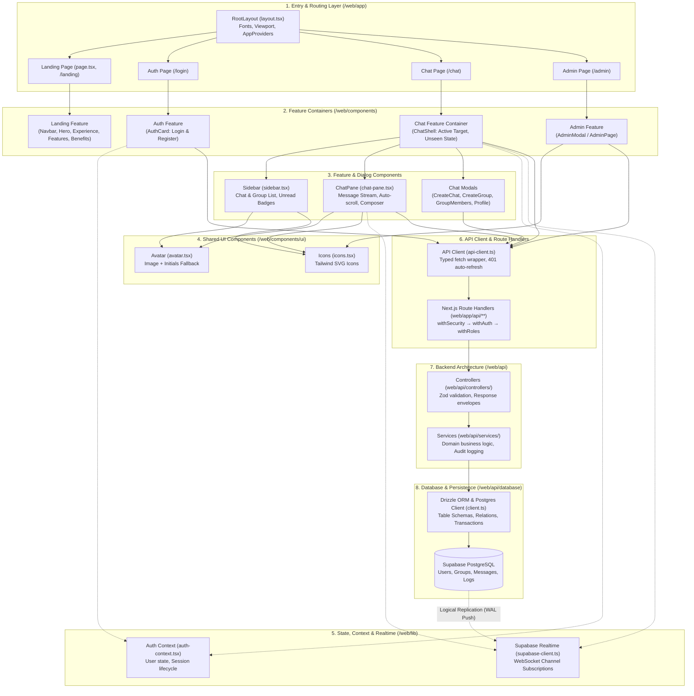

# Project Structure and Architecture

## Authority & Planning

- **Product scope & requirements:** `PROJECT.md`
- **Part 1 execution plan & API contract:** `01_api-and-chat/IMPLEMENTATION_PLAN.md` & `01_api-and-chat/API.md`
- **Part 2 landing page plan & spec:** `02_creative-landing-page/IMPLEMENTATION_PLAN.md` & `02_creative-landing-page/LANDING_PAGE_SPEC.md`
- **Part 3 submission & write-up plan:** `03-submission-and-write-up/IMPLEMENTATION_PLAN.md`
- **Engineering thought process:** `THOUGHT_PROCESS.md`
- **Implemented API reference:** `implemented_api.md`
- **Supabase Realtime setup guide:** `supabase_realtime.md`
- **Factual record of completed work:** `PROJECT_PROGRESS.md`
- **User guide & setup instructions:** `README.md` and `web/README.md`

---

## Technology Stack

- **Framework:** Next.js 16 (App Router, Turbopack) & React 19 inside `web/`.
- **Backend & API Architecture:** Integrated entirely within Next.js under `web/api/` (domain layers) and `web/app/api/` (HTTP route handlers). No separate backend process or root `api/` directory.
- **Styling & Animation:** Tailwind CSS v4 and Framer Motion.
- **Database & ORM:** Drizzle ORM with Supabase PostgreSQL (`postgres-js` driver); schema and migrations managed via Drizzle Kit.
- **Authentication & Security:** Email/password with bcrypt hashing (work factor 12), JWT sessions via `jose` (HS256) with HTTP-only cookie refresh token rotation and revocation, server-side RBAC (`user` | `admin`), and Zod environment validation.
- **Realtime Push:** Supabase Realtime (`@supabase/supabase-js`) WebSocket channels subscribed to PostgreSQL logical replication on `direct_messages` and `group_chat_messages` (zero client-side polling).
- **Validation:** Zod schemas for request bodies, query strings, route parameters, and environment variables.
- **Code Quality:** TypeScript 5 (Strict mode), ESLint 9 (Flat config), and Prettier.

---

## Repository Map

The repository root houses specifications, implementation plans, agent skills, documentation, and shared environment templates. All runnable application code resides inside `web/`.

```text
/
├── 01_api-and-chat/                # Part 1 plans, API contract (API.md), and data model specifications
├── 02_creative-landing-page/       # Part 2 plans and landing page copy/design spec (LANDING_PAGE_SPEC.md)
├── 03-submission-and-write-up/     # Part 3 verification and write-up plans
├── .agents/skills/                 # Repository-specific agent skills providing architectural guardrails
│   ├── api-data-layer/             # Skill: Route Handlers, Drizzle data access, pagination, contracts
│   ├── architecture/               # Skill: Project layout, layering, and data flow (this skill)
│   ├── auth-rbac/                  # Skill: Authentication, token lifecycle, RBAC enforcement
│   ├── coding-standards/           # Skill: TypeScript strict mode, ESLint, Prettier conventions
│   ├── environment-secrets/        # Skill: Secrets handling, .env files, server-side Zod validation
│   ├── follow-relevent-skill/      # Skill: Mandatory skill discovery and invocation workflow
│   ├── git-workflow/               # Skill: Commit conventions, scope control, PROJECT_PROGRESS updates
│   ├── realtime-state/             # Skill: Supabase Realtime subscriptions and client state
│   ├── ui-design-system/           # Skill: Tailwind CSS v4, Framer Motion, accessible UI patterns
│   └── verification/               # Skill: Quality gates, automated test suites, and build verification
├── .env.example                    # Root environment variable template
├── .gitignore                      # Git exclusion rules for secrets, builds, and node_modules
├── PROJECT.md                      # Central product specification and requirement source
├── PROJECT_PROGRESS.md             # Factual record of completed and verified implementation steps
├── README.md                       # Root documentation, live link, local run commands, and overview
├── THOUGHT_PROCESS.md              # Comprehensive Part 3 engineering reflection and write-up
├── implemented_api.md              # Reference catalog of implemented REST endpoints
├── supabase_realtime.md            # Supabase Realtime replication configuration and SQL instructions
└── web/                            # Full-stack Next.js 16 application (npm cwd)
    ├── package.json                # Dependencies, build, test, lint, and Drizzle scripts
    ├── tsconfig.json               # TypeScript path aliases (@/* -> ./, @api/* -> ./api)
    ├── next.config.ts              # Next.js configuration and environment resolution
    ├── eslint.config.mjs           # ESLint flat configuration (Next.js + Prettier)
    ├── .prettierrc                 # Prettier code formatting rules
    ├── .prettierignore             # Prettier ignore patterns
    ├── .gitignore                  # Web-level gitignore
    ├── .env.example                # Web-level environment variable template
    ├── .env                        # Local development secrets (gitignored)
    ├── README.md                   # Web package quick-start guide and script reference
    ├── vercel.json                 # Vercel deployment configuration
    ├── app/                        # Next.js App Router (pages, layouts, and HTTP routes)
    │   ├── layout.tsx              # Root HTML layout, Geist fonts, global CSS, viewport metadata
    │   ├── page.tsx                # Root public entry point rendering the Landing Page
    │   ├── globals.css             # Tailwind CSS v4 stylesheet and theme variables
    │   ├── favicon.ico             # Application favicon
    │   ├── landing/                # Public Landing Page route (/landing)
    │   ├── login/                  # Authentication page (/login) with login/register card
    │   ├── chat/                   # Authenticated Realtime Chat interface (/chat)
    │   ├── admin/                  # Protected Administrative Oversight route (/admin)
    │   └── api/                    # HTTP Route Handlers (route layer delegating to web/api)
    │       ├── hello/              # GET /api/hello (health check)
    │       ├── auth/               # Endpoints: register, login, refresh, logout, bootstrap-admin
    │       ├── users/              # Endpoints: GET/PATCH /api/users/me, GET /api/users (search)
    │       ├── conversations/      # Endpoints: GET/POST /api/conversations/direct, messages history
    │       ├── groups/             # Endpoints: GET/POST /api/groups, members, messages history
    │       └── admin/              # Endpoints: users list, role, status, activity logs, inspection
    ├── api/                        # Modular backend domain architecture inside web/
    │   ├── index.ts                # Central barrel export for the backend API layers
    │   ├── authentication/         # JWT tokens, bcrypt password hashing, HTTP-only cookie handlers
    │   ├── configuration/          # Zod environment validation (serverEnvSchema) and CORS allowlist
    │   ├── controllers/            # HTTP controllers parsing requests and assembling JSON responses
    │   ├── database/               # Drizzle client, table schemas, migrations, and seed scripts
    │   │   ├── client.ts           # getDb() singleton instance using postgres-js connection pool
    │   │   ├── drizzle.config.ts   # Drizzle Kit migration configuration
    │   │   ├── schema/             # Declarative Drizzle PostgreSQL table schemas and relations
    │   │   ├── migrations/         # Generated SQL migrations (0000, 0001, 0002)
    │   │   └── seed.ts             # Idempotent database seeder with bcrypt cost factor 12
    │   ├── errors/                 # Standard error codes and AppError subclass hierarchy
    │   ├── middlewares/            # Reusable HTTP middlewares (withSecurity, withAuth, withRoles)
    │   ├── services/               # Core business logic, authorization checks, and database queries
    │   ├── test/                   # Automated API test suites (security, auth, rbac, chat, realtime)
    │   ├── utils/                  # Standard response envelopes (apiSuccess, apiError) and parsers
    │   └── validation/             # Zod validation helpers and error formatting utilities
    ├── components/                 # React UI components (Tailwind CSS v4 + Framer Motion)
    │   ├── admin/                  # Admin oversight modal (user management, audit logs, conversations)
    │   ├── auth/                   # AuthCard with login/registration forms and 1-click test accounts
    │   ├── chat/                   # ChatShell, Sidebar, ChatPane, and modal dialogs
    │   ├── landing/                # Landing page components (Navbar, Hero, Experience, Features, etc.)
    │   ├── ui/                     # Shared UI primitives: Avatar (with fallback) and pure SVG Icons
    │   ├── providers.tsx           # Client context provider wrapper (AppProviders)
    │   └── foundation-status.tsx   # Visual status card for verification
    ├── lib/                        # Client-side infrastructure, contexts, and API wrappers
    │   ├── api-client.ts           # Strongly-typed fetch client with automatic 401 token refresh
    │   ├── auth-context.tsx        # React AuthContext providing session state, login, and logout
    │   ├── supabase-client.ts      # Browser Supabase client singleton for Realtime WebSocket events
    │   └── env/public.ts           # Client-safe public environment variable access
    └── public/                     # Static assets served directly by Next.js
```

---

## Folder Purposes (Quick Reference)

| Folder                         | One-Line Purpose                                                                                                  |
| ------------------------------ | ----------------------------------------------------------------------------------------------------------------- |
| `/.agents/skills/`             | Repository-tailored agent skills providing operational instructions and architectural guardrails.                 |
| `/01_api-and-chat/`            | Specifications, API contract (`API.md`), and implementation plan for Part 1.                                      |
| `/02_creative-landing-page/`   | Implementation plan and copy/design specification (`LANDING_PAGE_SPEC.md`) for Part 2.                            |
| `/03-submission-and-write-up/` | End-to-end verification and documentation plan for Part 3.                                                        |
| `/web/`                        | Root of the Next.js full-stack application and npm workspace cwd.                                                 |
| `/web/app/`                    | Next.js App Router containing React page layouts, views, and HTTP API route handlers.                             |
| `/web/app/api/`                | HTTP Route Handlers (`route.ts`) serving as the route layer, applying middlewares and dispatching to controllers. |
| `/web/api/`                    | Decoupled backend architecture containing domain services, controllers, database, and auth.                       |
| `/web/api/authentication/`     | JWT configuration, access/refresh token signing/verification, bcrypt hashing, and cookie helpers.                 |
| `/web/api/configuration/`      | Server-side Zod environment validation and CORS origin checking.                                                  |
| `/web/api/controllers/`        | HTTP request validation, controller orchestration, and JSON response assembly.                                    |
| `/web/api/database/`           | Drizzle ORM client, table schemas, SQL migrations, and idempotent seed scripts.                                   |
| `/web/api/errors/`             | Standard error codes, custom error hierarchy (`AppError`), and error formatting.                                  |
| `/web/api/middlewares/`        | Reusable HTTP middlewares for security (`withSecurity`), JWT auth (`withAuth`), and RBAC (`withRoles`).           |
| `/web/api/services/`           | Pure business logic, permission rules, audit logging, and Drizzle database operations.                            |
| `/web/api/test/`               | Automated test suites executing against the live database and API layers.                                         |
| `/web/api/utils/`              | Shared utilities: standard response envelopes (`apiSuccess`, `apiError`) and safe request parsers.                |
| `/web/api/validation/`         | Zod validation utilities for request bodies, query parameters, and route parameters.                              |
| `/web/components/`             | React UI components organized by domain feature (`chat`, `admin`, `auth`, `landing`, `ui`).                       |
| `/web/components/admin/`       | Admin Oversight Console modal with user management, audit trails, and conversation inspection.                    |
| `/web/components/auth/`        | Authentication card with login, registration, and 1-click test credential pickers.                                |
| `/web/components/chat/`        | Realtime chat shell, conversation sidebar, active message pane, and chat modals.                                  |
| `/web/components/landing/`     | Public landing page components (Hero, Experience Sandbox, Features, Benefits, Demo Accounts).                     |
| `/web/components/ui/`          | Shared design system primitives: `Avatar` (with image error fallback) and pure SVG `Icons`.                       |
| `/web/lib/`                    | Shared client utilities: typed `ApiClient`, `AuthContext`, and browser `SupabaseClient`.                          |
| `/web/public/`                 | Static image and SVG assets served directly by Next.js.                                                           |

---

## UI Hierarchy & Request Flow

This section details how a user interaction flows through the Next.js UI structure from the initial browser request down to persistent data and downstream realtime push.

### UI Hierarchy Graph



### Layer Responsibilities Explained

1. **`/web/app` (Entry & Routing):**
   - Next.js App Router root layout (`layout.tsx`) initializes global styles, Geist typography, responsive dynamic viewport metadata (`h-dvh`, `interactiveWidget: 'resizes-content'`), and wraps the app with `AppProviders`.
   - Page entry points (`page.tsx`, `/landing`, `/login`, `/chat`, `/admin`) map incoming browser URLs to feature containers.

2. **Routes / Pages:**
   - Define URL endpoints and handle route-level lifecycle, server/client boundaries, and auth guards (e.g. `/chat` checks `useAuth()` and redirects unauthenticated users to `/login`).

3. **Feature Containers & Feature Components (`/web/components`):**
   - High-level containers (`ChatShell`, `AdminModal`, `AuthCard`, `Hero`) coordinate domain state, modal toggles, active conversation targets, and component composition.
   - Child components (`Sidebar`, `ChatPane`, `CreateChatModal`, `GroupMembersModal`) encapsulate feature-specific UI logic, user inputs, virtualized list flows, and interactive state.

4. **Shared UI Components (`/web/components/ui`):**
   - Reusable design system primitives: `Avatar` handles profile pictures with graceful fallback to two-character initials; `Icons` provides lightweight, accessible pure SVG icons.

5. **Hooks & State (`/web/lib`):**
   - `AuthContext` (`auth-context.tsx`) provides reactive global authentication state, token refresh lifecycle, and current user profile updates.
   - `SupabaseClient` (`supabase-client.ts`) provides a browser singleton that subscribes to PostgreSQL logical replication channels (`direct_messages` and `group_chat_messages`) for instant push updates without polling.
   - Component-level state (`useState`, `useRef`, `useCallback`) manages conversation selection, scroll positions, unseen message indicators, and message inputs.

6. **API Client & Route Layer:**
   - `ApiClient` (`api-client.ts`) serves as the typed frontend HTTP abstraction, centralizing JSON headers, standard error parsing, and transparent 401 token refresh retry.
   - Next.js Route Handlers (`web/app/api/**/route.ts`) act as the entry gateway on the server, applying security headers (`withSecurity`), JWT validation (`withAuth`), and RBAC authorization (`withRoles`).

7. **Backend Controllers & Services (`/web/api`):**
   - Controllers validate incoming request bodies, queries, and parameters using Zod schemas and format standard response envelopes (`apiSuccess`, `apiError`).
   - Domain services (`auth.service.ts`, `chat.service.ts`, `users.service.ts`, `admin.service.ts`) execute business rules (e.g. verifying group creator status), manage password hashing, and write audit trail records.

8. **Database Layer (`/web/api/database`):**
   - Drizzle ORM singleton (`client.ts`) connects to Supabase PostgreSQL using `postgres-js` with transaction pooling.
   - Typed schema definitions and relations enforce referential integrity across 8 tables.

9. **Downstream Realtime Delivery:**
   - When mutations commit to PostgreSQL, database WAL changes are published via Supabase Realtime to connected WebSocket clients, updating message panes and unread badges immediately.

---

## Architectural Layers & Responsibilities (Backend API)

The backend follows a decoupled, layered architecture entirely inside `web/api/`:

```text
[ Browser / Client ]
         │  HTTP Request
         ▼
[ Route Layer (Next.js App Router) ] ──>  web/app/api/**/route.ts
         │
         ├─── [ Middlewares Layer ]  ──>  web/api/middlewares/ (withSecurity, withAuth, withRoles)
         │           │
         │           ▼
         │      [ Authentication ]   ──>  web/api/authentication/ (jose, JWT, cookies)
         ▼
[ Controllers Layer ]   ──>  web/api/controllers/*.ts (validates inputs, formats responses)
         │
         ▼
[ Services Layer ]      ──>  web/api/services/*.ts (core domain logic, audit logs)
         │
         ▼
[ Database Layer ]      ──>  web/api/database/ (getDb via Drizzle ORM)
         │
         ▼
[ Supabase PostgreSQL ] ──>  Persistent storage
```

### 1. Route Handlers (`web/app/api/`)

- Pure Next.js App Router handlers (`export async function GET/POST/PATCH/OPTIONS`).
- Serves as the single **Route Layer**: applies middleware wrappers (`withSecurity`, `withAuth`, `withRoles`) and delegates directly to controllers.
- Eliminates duplicate routing boilerplate while keeping business logic decoupled and testable.

### 2. Middlewares (`web/api/middlewares/`)

- `withSecurity`: Injects security headers (`X-Content-Type-Options`, `X-Frame-Options`, `Referrer-Policy`, `Permissions-Policy`), handles CORS origin checking against allowlist, and returns 204 for OPTIONS preflight.
- `withAuth`: Extracts Bearer token, validates JWT via `jose`, verifies user active status and current role against the live database, and attaches `ApiContext` (`userId`, `role`, `email`).
- `withRoles`: Denies access with 403 Forbidden if the authenticated user lacks the required role (`user` | `admin`).

### 3. Controllers (`web/api/controllers/`)

- Handle request-level concerns: parse body/query/params using Zod schemas (`web/api/validation/`), trigger domain service methods, catch errors, and format standard HTTP JSON envelopes via `apiSuccess` / `apiError`.

### 4. Services (`web/api/services/`)

- Encapsulate business logic, authorization rules (e.g. `loggedInUser.email === group.creator_email`), validations, calculations, and database queries.
- Write tamper-evident audit logs to `activity_logs` for sensitive actions (`USER_ROLE_CHANGE`, `USER_STATUS_CHANGE`, `GROUP_CREATE`, `GROUP_ADD_MEMBER`, `ADMIN_VIEW_CONVERSATION`).
- Services are decoupled from HTTP and do not manipulate raw Request or Response objects.

### 5. Database (`web/api/database/`)

- Provides `getDb()` singleton instance powered by Drizzle ORM and `postgres-js`.
- Maintains declarative table schemas in `web/api/database/schema/` (`users`, `roles`, `groups`, `group_members`, `direct_messages`, `group_chat_messages`, `refresh_tokens`, `activity_logs`).
- Configured for Drizzle Kit schema migrations via `web/api/database/drizzle.config.ts`.

### 6. Authentication (`web/api/authentication/`)

- Centralizes JWT secret resolution and TTL configuration (`jwt.config.ts`).
- Issues short-lived access tokens (15m) and long-lived refresh tokens (7d) hashed via SHA-256 in `refresh_tokens`.
- Issues refresh tokens inside secure HTTP-only cookies (`Path=/api/auth`, `SameSite=Lax`, `HttpOnly`).
- Bcrypt password hashing with cost factor 12 (`password.ts`).

### 7. Configuration (`web/api/configuration/`)

- Centralizes reading and Zod validation of server environment variables (`DATABASE_URL`, `JWT_ACCESS_SECRET`, `JWT_REFRESH_SECRET`, `NEXT_PUBLIC_APP_URL`, `NEXT_PUBLIC_SUPABASE_URL`, `NEXT_PUBLIC_SUPABASE_ANON_KEY`).
- Throws descriptive `MissingEnvError` when a required variable is missing.

---

## Data Flow & Direction of Dependencies

1. **Inward Dependencies:** Outer transport layers (`app/api`) depend on inner API layers (`controllers` -> `services` -> `database`).
2. **Never Upward:** Services never import controllers or Next.js route handlers.
3. **Database Isolation:** Database queries occur strictly in services or database helpers, never directly inside React UI components or Next.js route handlers.
4. **Client-Side Writes Blocked:** Frontend components never write directly to Supabase; all mutations pass through Next.js API route handlers to ensure strict server-side validation and RBAC.
5. **Secrets Isolation:** Server secrets (`DATABASE_URL`, `JWT_ACCESS_SECRET`, `JWT_REFRESH_SECRET`) are accessed strictly through server modules (`web/api/configuration/env.ts`) and must NEVER be imported into React client components or exposed with `NEXT_PUBLIC_`.

---

## Conventions for Extending the Architecture

When adding new features:

1. **Define Drizzle Schema:** Add or modify table schemas in `web/api/database/schema/` and export from `web/api/database/schema/index.ts`.
2. **Generate Migration:** Run `npm run db:generate` and apply with `npm run db:migrate`.
3. **Implement Domain Service:** Add business logic and Drizzle queries in `web/api/services/<resource>.service.ts`.
4. **Implement Controller:** Add input validation and response assembly in `web/api/controllers/<resource>.controller.ts`.
5. **Implement App Router Endpoint:** Create `web/app/api/<resource>/route.ts` wrapping controllers with required middlewares (`withSecurity`, `withAuth`, `withRoles`).
6. **Expose Typed Client Method:** Add typed fetch method in `web/lib/api-client.ts`.
7. **Build UI Components:** Implement feature components under `web/components/<feature>/` and wire up to pages under `web/app/<feature>/`.
8. **Automated Verification:** Run `npm run lint`, `npm run format:check`, `npm run test:all`, and `npm run build` from `web/`.
